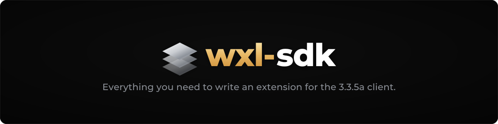

<div align="center">



[](LICENSE)
[](#-install-the-sdk)
[](docs/migrating-to-1.3.md)
[](#-install-the-sdk)

[First extension](#-write-your-first-extension) · [Guides](#-guides) · [Install](#-install-the-sdk) · [CMake](#-cmake-functions) · [Tests](#-tests)

</div>

---

## ✨ What it is

The WarcraftXL SDK is what an extension builds against: the headers, the game bindings, the client's
offsets and a CMake package. An extension is its own repository and its own DLL; the
[core](https://github.com/WarcraftXL/wxl-core) loads `Extensions\<name>\<name>.dll` after reading
`Extensions\<name>\wxl.json`.

- **One class per extension.** Derive `Extension`, override the events you need (only those are
  connected), connect handlers with `On<Tag>`; `Export` makes it the DLL, named by its `wxl.json`.
- **Hooks and patches.** Interceptors on client functions for every extension; raw hooks and byte
  patches for the extensions that ask for `low_level`. A patch's expected bytes are checked first, and
  put back when the extension is disabled.
- **Services.** Publish a table of functions for other extensions, or use theirs: `Service<T>` finds it
  by type, `OnReady` runs once it is there.
- **Settings.** Declare an annotated struct; the player gets an `.ini`, `/wxl get` and `/wxl set`, and
  any settings screen built on the `wxl.settings` service.
- **Tested without the client.** A fake host loads your DLL, raises events and checks what it logged.

The SDK targets the **32-bit Windows client only** (build 12340): everything builds for Win32, and a
configure for any other target is refused.

## 🚀 Write your first extension

`examples/hello` is the smallest extension: an override counting frames, and a handler on the
player's target.

<!-- quote: examples/hello/Hello.cpp -->
```cpp
#include <wxl/Game.hpp>
#include <wxl/wxl.hpp>

using namespace wxl;

class Hello : public Extension
{
    uint32_t ticks = 0;

    void OnStart() override
    {
        Log::Info("{} {} started", Name(), Version());

        On<TargetChanged>([](auto&)
        {
            if (auto me = Game().Player())
                Log::Info("level {} player changed target", me->Level().ValueOr(0));
        });
    }

    void OnUpdate(float, uint32_t) override
    {
        ++ticks;
    }

    void OnWorldEnter(MapId map) override
    {
        Log::Info("map {} after {} ticks", map, ticks);
    }
};

Export<Hello> extension;
```

`Export<Hello> extension;` writes the entry points and takes the name and version from `wxl.json`;
the core then starts the extension: `OnStart`, then the events it overrides.

Its `CMakeLists.txt`, its manifest (`wxl.json`), the build, the test in the fake host and the copy into a
client are in [docs/getting-started.md](docs/getting-started.md).

## 📚 Guides

| Guide | What it covers |
|---|---|
| [Getting started](docs/getting-started.md) | install, build an extension, test it in the fake host, put it in a client |
| [Listen to an event](docs/listen-to-an-event.md) | overrides, `On` handlers, signals, priorities, answers |
| [The events](docs/events.md) | every event: id, args, tag, when it is raised |
| [Add a hook](docs/add-a-hook.md) | interceptors, raw hooks with `low_level` |
| [Publish a service](docs/publish-a-service.md) | publish and use a service, its traits, `OnReady`, versions |
| [Add settings](docs/add-settings.md) | annotated settings, the settings tool, the ini, `/wxl` |
| [Migrating to 1.3](docs/migrating-to-1.3.md) | what breaks from 1.2, and the steps |

`examples/` holds one small extension per pattern, each built against the installed SDK and loaded in
the fake host:

| Example | Shows |
|---|---|
| `hello` | the smallest extension: an override and a handler |
| `events` | overrides and handlers: priority, once, a filtered signal, answers |
| `observe` | observable properties, object handles, the `Game` facade |
| `settings` | annotated settings and a coroutine |
| `service` | publish a service, its C++ wrapper, and use it with `OnReady` |
| `intercept` | interceptors on client functions |
| `hook` | a raw hook, with `low_level` |

The API reference is generated offline from the headers' doc comments:
`python3 tools/docgen/generate.py` writes it to `docs/site/`.

## 📦 Install the SDK

CMake 3.20 or later and a C++20 compiler targeting Win32: Visual Studio 2022, clang-cl, or clang
mingw-w64.

```sh
cmake -S wxl-sdk -B build -A Win32
cmake --install build --prefix C:/wxl-sdk
```

From Linux, use `-G Ninja -DCMAKE_TOOLCHAIN_FILE=<an x86 Windows toolchain file>` instead of
`-A Win32`. An extension then finds the SDK with `find_package(WarcraftXL 1.3)` and
`-DCMAKE_PREFIX_PATH=<prefix>`.

## 🧱 Layout and targets

| Path | What |
|---|---|
| `include/wxl/` | the C++ layer: `wxl.hpp` (all of it), `Extension.hpp` and `Overrides.def`, `Export.hpp`, `Listener.hpp`, `Log.hpp`, `Events.hpp` and `events/`, `Signal.hpp`, `Hook.hpp`, `Intercept.hpp`, `Patch.hpp`, `Service.hpp` and the core's services (`Storage.hpp`, `Profiles.hpp`, `AllSettings.hpp`), `Settings.hpp`, `Result.hpp`, `Task.hpp`, `Game.hpp`, the hook-point names (`HookPoints.def`) |
| `include/wxl/abi/` | the C ABI: `Plugin.h`, `Common.h`, `Version.h`, and the tables of the core's services (`Storage.h`, `Objects.h`, `Settings.h`, `Profiles.h`, `Lua.h`, `GraphicsDevice.h`) |
| `include/wxl/offsets/` | the stock client's addresses, signatures and layouts, one header per class, classes named alike but for case sharing the first's (generated) |
| `include/wxl/game/`, `include/wxl/objects/` | typed bindings over the client's functions and state, and the object handles |
| `include/wxl/formats/` | file records as the client reads them |
| `tools/` | `offsets/` (the generator), `abi/` (the ABI lock), `settings/` (the settings tool), `docgen/`, `fake-host/` |

Every directory under `include/wxl/` is named after its namespace. The SDK is headers only; the three
targets say what an extension builds on: `WarcraftXL::sdk` (the C++ layer and the ABI),
`WarcraftXL::offsets` (adds the client's offsets), `WarcraftXL::game` (adds the bindings and objects).

## 🧰 CMake functions

```
wxl_add_extension(<name> SOURCES <file>... [MANIFEST <wxl.json>] [VERSION <x.y.z>]
                  [LINK <target>...] [SETTINGS <header>...] [OUTPUT_DIRECTORY <dir>])
```

Builds `<name>.dll` (Win32, C++20, static runtime, always linked to `WarcraftXL::sdk`) and writes
`wxl.json` beside it, in `<build>/Extensions/<name>/`: your `MANIFEST` with `extension.abi` set to this
SDK's version, or a minimal one (`VERSION`, default 0.1.0). `SETTINGS` generates
`<stem>.settings.hpp` beside each settings header ([add-settings.md](docs/add-settings.md)).
`-DCLIENT_PATH=<client folder>` copies the result into that client after each build;
`cmake --install` puts it under `<prefix>/Extensions/<name>/`.

```
wxl_add_unit_test(<name> SOURCES <file>... [LINK <target>...] [INCLUDE <dir>...] [ARGS <arg>...])
```

A test program `<name>`, built like an extension (C++20, the same runtime and definitions, linked to
`WarcraftXL::sdk`), run by ctest under the same name.

```
wxl_add_abi_lock(<name> LOCK <file> INCLUDE <dir>... HEADERS <path>... [EVENTS <Events.def>]
                 [MAJOR <macro>...] [MINOR <macro>...])
```

A ctest that fails when the C ABI of the headers is not the one in the checked-in lock file: the
layout of every `typedef struct`, the `#define` values, the enumerators, the event rows. The message
says whether the versions a change needs have moved: an addition a `MINOR` (or `MAJOR`) macro, a break
a `MAJOR` one, a table `WXL_<Name>Api` its own `WXL_<NAME>_API_VERSION`. Only
`cmake --build <tree> --target <name>-update` rewrites the lock, and it refuses while a bump is
missing. Needs LuaJIT and clang (clang-cl); without them the test is not added.

```
wxl_add_load_test(<name> [ARGS --world <mapId> --expect-log "<line>"...])
```

Adds a ctest that loads the extension in the SDK's fake host, without a client: it checks the
manifest, the exports and the info block (its name and version against `wxl.json`), runs `WXL_Load`,
allows hooks on known hook points only and raw hooks and patches only with `low_level`, raises
`OnExtensionsLoaded`, three `OnUpdate` (and `OnWorldEnter` with `--world`), unloads the DLL, and fails
on a missing expected log line or a connection left once unloaded.

The three test functions need `enable_testing()` first. Everything built on `WarcraftXL::sdk`
compiles its floats to SSE2 (`/arch:SSE2`): the client's conventions are unchanged, a float result
still comes back in ST0.

## 📋 The manifest and versions

The core reads `extension.abi` (`"major.minor"`) from `wxl.json` before it opens the DLL: same major
as the core and a minor no greater than its own loads; anything else, or no `wxl.json`, is refused
with the reason in `Logs\wxl-core.log`.

| Field | What |
|---|---|
| `extension.load` | `"engine"` (the default) or `"before-archives"`, for an extension that must load before the client mounts its archives |
| `"permissions": { "low_level": true }` | grants raw hooks and patches |

A minor version only adds (events, hook points, services, members at the end of a table);
`wxl/Version.h` holds the numbers, and `abi.lock` the ABI they stand for (ctest `abi-lock`).

## 🧪 Tests

```sh
cmake -S wxl-sdk -B build -A Win32
cmake --build build --config Release
ctest --test-dir build -C Release
```

- every public header compiles on its own;
- overrides, `On` handlers, `OnReady`, the log, signals, object handles, coroutines, settings and
  interceptors run against a fake core, and the `WXL_SEH_TRY` guard through faults;
- dispatching an event to an override or a handler, a log line, an intercepted call or a frame of the
  task scheduler allocates nothing;
- the settings tool's output is compared with the committed one;
- the package is installed, the examples are built against it and loaded in the fake host;
- the code the docs quote is checked against the examples, and `docs/events.md` against the event table (`docs-quotes`);
- the C ABI is held to `abi.lock`.

From Linux, set `CMAKE_CROSSCOMPILING_EMULATOR` to a wine wrapper before configuring so ctest runs
the Windows executables under wine.

## 🤝 Contributors

Thanks to everyone who has helped shape WarcraftXL, with code, reverse-engineering, ideas, or feedback:

- [Furioz](https://github.com/Furioz420)
- [Tester](https://github.com/TesterWoWDev)
- [Duskhaven](https://git.duskhaven.net/Duskhaven)

## 💜 Support

Sponsoring is optional.

<p align="center">
  <a href="https://github.com/sponsors/iThorgrim"></a>
</p>

## ⚖️ Legal

WarcraftXL is an **interoperability project**. It distributes no Blizzard code and no game assets, and
runs only against a client you supply and own, reading that client's own files at runtime.
Reverse-engineering is limited to what is necessary for interoperability.

World of Warcraft and Wrath of the Lich King are trademarks of Blizzard Entertainment. This project is
not affiliated with or endorsed by Blizzard.

## 📄 License

Released under the **GNU General Public License v3.0 or later** - see [LICENSE](LICENSE).
